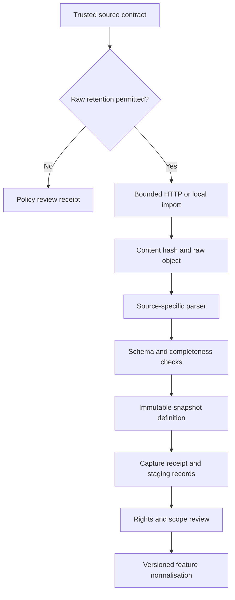

# Input collection and evidence contracts

The collector preserves exactly what a source returned and states what it has not established. Fetching a layer is one step towards an assessment; it is not evidence that an unlisted property is clear of a hazard.

## Running it

The reusable Python interface is:

```python
from riskengine.ingestion import collect, load_registry

registry = load_registry()  # or load_registry("config/sources.json")
source = next(s for s in registry if s["source_id"] == "act_blocks")
result = collect(
    source,
    "var/ingestion",
    bounds={"where": "DIVISION = 'KINGSTON'", "out_sr": 4326},
    max_records=1000,
    max_bytes=20_000_000,
)
print(result["status"], result["snapshot_id"])
```

That cadastral example returns `POLICY_REVIEW_REQUIRED` until the source contract has an approved raw-retention decision. The distributed registry keeps source rights closed except for the specifically reviewed ACT Crime Statistics source, whose publisher metadata explicitly declares CC BY 4.0. Selecting an adapter or reaching a public URL does not change those rights. A curator must record the actual source terms, the intended use, attribution requirements and the authorised rights decision before changing `rights.retain_raw` to `true`. Collection permission does not imply permission to derive features, display records or redistribute a dataset; those decisions remain separate downstream gates.

`act_crime_statistics` is enabled for attributed collection and display under that source-specific review. `canberra_crm01` is a confirmed alias of the same publisher catalogue, retained as a disabled entry so the original source claims remain traceable. The registry still has 83 entries; that is not a count of distinct datasets or independent evidence. The live collection check in `docs/live_collection_check.json` states the actual execution outcome and vintage. The asset currently identified by the reviewed catalogue ends at 2025 Q2, so freshly fetching it does not make its observations current.

`enabled` is a scheduling flag. Calling `collect` explicitly does not activate a scheduled feed. Only trusted registry contracts should reach `collect`; an HTTP API must accept source IDs and look them up server-side. It must not accept arbitrary source dictionaries, endpoint URLs, local paths or authentication settings from a buyer.

`RISK_SOURCES_PATH` can select another registry on the operator's filesystem. A registry is either a JSON array or an object with a `sources` array. Source IDs must be unique. There are three candidate locations when no path is specified: the checkout's `config/sources.json`, packaged `riskengine/data/sources.json`, and the current directory's `config/sources.json`.

## End-to-end ingestion flow



The first nine nodes are implemented here. Rights and scope review and domain normalisation are explicit subsequent operations. The collector never manufactures normalised property observations from a catalogue title, a successful request or an empty feature list.

## Storage and reproducibility

Each run creates:

- `raw/<first-two-hash-characters>/<sha256>.<format>`: the response body, after normal HTTP content decoding. Identical retained bytes reuse the same object.
- `snapshots/<sha256>.json`: a stable manifest containing source identity, endpoint, query scope, parser version, rights-contract hash, payload hashes, completeness and a records hash.
- `receipts/<sha256>.json`: one capture receipt containing retrieval time, requests, returned records, schema, errors and raw-object references.

The snapshot identifier excludes the wall-clock retrieval time and receipt path. Identical bodies, source contract, parser version and requested scope produce the same snapshot ID; the second retrieval still produces a new receipt. This is idempotent storage, not an assertion that the public network is deterministic. Provider metadata can change independently of feature rows and legitimately change the snapshot.

`retrieved_at` is when this collector ran. `source_published_at` is supplied source publication evidence, if the approved contract has it; it remains null when unknown. RBA row metadata also preserves its publication date. ArcGIS last-edit timestamps and crime catalogue modification timestamps remain labelled in source metadata. None are silently substituted for observation dates, legal effective dates or the date an historical decision-maker could have known the data. `faithful_historical_replay` defaults to `false`. A captured current payload cannot establish an accurate historical replay by itself.

Snapshots are immutable through the normal writer. The included filesystem backend is not a regulatory write-once store: a privileged filesystem user can still alter files. The production architecture must add access controls, object versioning/retention, backup, checksum verification and the required tenant separation.

## Result contract

| Field | Meaning |
|---|---|
| `source_id`, `snapshot_id`, `adapter_version` | Source and exact ingestion implementation identity |
| `status` | Outcome of this collection attempt; see below |
| `retrieved_at`, `source_published_at` | Distinct capture and publication time evidence |
| `raw_files` | Hash, byte count, local path, response type, redacted URL and available HTTP metadata |
| `records` | Source-preserving records; not approved risk observations |
| `schema` | Source fields, units, CRS, file metadata and parser details |
| `completeness` | Expected count, returned count, cap status and requested scope |
| `coverage` | Always `NOT_ESTABLISHED`; collection does not prove property/mechanism coverage |
| `errors` | Explicit machine-readable codes and descriptions |
| `rights`, `rights_status` | The supplied rights decision and licence-review status, carried without promotion |
| `requests`, `bytes_received` | Bounded-attempt audit, when a transport was created |
| `snapshot_manifest`, `receipt_path` | Paths to the saved result evidence |

| Status | Interpretation |
|---|---|
| `SUCCESS` | The requested structured collection reconciled, or a raw file was captured. Inspect `completeness.status` and `schema.parse_status` before use. |
| `PARTIAL` | A cap, mismatch, duplicate, geometry error or unproved generic pagination prevents a completeness claim. |
| `REFERENCE_ONLY` | A catalogue, documentation page or HTML download listing was captured; no property facts were produced. |
| `POLICY_REVIEW_REQUIRED` | Raw retention is false or absent; no source request or source-byte copy occurred. |
| `ACCESS_REQUIRED` | Authorised credentials or the verified credential mapping are missing, or access was denied. |
| `MANUAL_INPUT_REQUIRED` | This is a manual contract, not an implemented retrieval route. |
| `UNAVAILABLE` | The endpoint, schema, body size, service or network did not permit a valid collection. Any retained earlier bodies remain evidence, not a complete dataset. |
| `INVALID_RESPONSE`, `UNSUPPORTED` | A response/configuration could not be parsed, or the adapter is unimplemented. |

An empty, reconciled query may legitimately be `SUCCESS` with zero rows and `completeness.status=COMPLETE`. Its coverage is still `NOT_ESTABLISHED`. Downstream spatial checks must independently establish the relevant layer's coverage, validity and suitability before distinguishing a positive overlap, boundary touch, non-overlap and outside coverage.

## Implemented adapters

| Adapter | Input and processing | Completeness and limitations |
|---|---|---|
| `arcgis` | Exact numbered FeatureServer or MapServer layer. Retain metadata; query count; enumerate object IDs; retrieve sorted batches of at most 200 IDs; reconcile IDs and rows. | Complete only when the source count, IDs and distinct returned records agree without issues. Source edits during the sequence are not transactionally locked. No automatic service-directory discovery. |
| `socrata` | `/resource/abcd-1234.json` table. Count query, stable row-ID ordering, bounded offset pages, duplicate checks. | Complete only when distinct rows reconcile to count. A changing source can still prevent a consistent point-in-time dataset. Blob/catalogue endpoints are rejected as table endpoints. |
| `rba_csv` | Published metadata CSV. Read named series IDs, publication rows, frequency and units; retain missing observations. | Defaults to `FIRMMCRTD` when present, otherwise all published series. Decimal values remain strings; percent-to-fraction is explicit in `value_decimal`. Records are newest first; a cap is partial. RBA terms still require source-specific review. |
| `crime_xlsx` | ACT quarterly crime workbook. Read stacked offence headers, quarters and reporting-area rows; retain cell/sheet evidence. Optional catalogue-driven current blob discovery. | Area and period selection before record cap. TIN/CIN infringement activity is separate from reported offences. Counts are not population-adjusted crime risk. Unknown/suppressed cells do not become zero. |
| `sdmx_csv` | Exact SDMX data query returning CSV with `OBS_VALUE`. Retain every dimension, time period, unit and multiplier. | No assumptions about cross-dimension summation or unit conversion. Dataflow-discovery XML is rejected as data. A cap is partial. |
| `gtfs_zip` | Authorised schedule ZIP. Bounded expanded size, duplicate-member check, required schedule-file presence, table row counts and string-preserving rows. | A row cap is partial. Structural checks do not provide full GTFS referential validation, walking-network travel times or future infrastructure benefits. Existing services remain distinct from planned projects. |
| `generic_json` | JSON endpoint or selected local JSON file; optional `records_path`. | Source-preserving capture only. Pagination completeness remains `UNKNOWN`; the generic adapter does not pretend to understand an undocumented API. |
| `file_download` | Published file or selected local file. | `FILE_CAPTURED` means raw retention only. HTML download listings become `REFERENCE_ONLY`. A format-specific normaliser is still required. |
| `discovery` | JSON catalogue, XML service description or HTML reference page. | `REFERENCE_ONLY`; retains source evidence and produces no property-fact rows. |
| `manual` | Operator/buyer input specification. | No data fetch. Reports the required input honestly. Uploaded buyer material must enter the private case workflow. |

### ArcGIS geometry and CRS

ArcGIS records carry `attributes`, `source_record_id`, original returned `source_geometry`, converted `geometry`, a separate `crs` object and `geometry_status`. The converted object uses GeoJSON geometry structure; if a caller chooses a projected output CRS, it is **not** a standalone RFC 7946 geographic GeoJSON document. Consumers must read `crs` and perform an explicit validated transformation before distance/area operations.

Polygon holes are determined by ring containment, rather than assuming ring orientation. Nested islands remain separate components. Invalid rings or overlapping components are retained raw and reported; they are not repaired silently. Coordinate simplification, clipping and `maxAllowableOffset` are not used. A bounding-box query selects intersecting features and preserves the complete returned geometries. One very large polygon may exhaust the byte budget even when `max_records=1`; the outcome is partial/unavailable, never clear of the hazard.

The collector retains native layer CRS, output CRS and field metadata. It does not choose the legally relevant current parcel, reconcile retired blocks, resolve addresses, interpret development decision codes or select flood mechanisms. Those are versioned domain-normalisation decisions.

### Crime workbook discovery and meaning

Use `parameters.catalogue_id` and `parameters.discover_latest=true` to read the catalogue's current `blobId` and `blobFilename`. A configured `file_url` is used as the pinned asset only when live discovery is disabled. The collector never silently falls back to an old pinned workbook after discovery fails. The expected vintage is retained for review, while `schema.actual_last_period` reports the parsed workbook's latest quarter.

Crime observations preserve a publisher reporting area. A label such as KINGSTON must be reconciled to the correct boundary/version before joining it to a property. Reported offences, police enforcement activity, population denominators and exposure are different quantities. This adapter calculates no rates or score. The source's own description also explains that reports can be revised and small numbers can create large percentage changes; see the [ACT crime catalogue metadata](https://www.data.act.gov.au/api/views/2egm-dieb.json).

## Source contract parameters

```json
{
  "source_id": "reviewed_example",
  "adapter": "arcgis",
  "endpoint": "https://official.example/arcgis/rest/services/Layer/FeatureServer/0",
  "enabled": false,
  "licence_status": "REVIEWED_FOR_STATED_USE",
  "rights": {
    "retain_raw": true,
    "process": false,
    "display_raw": false,
    "display_derived": false,
    "review_reference": "approved source-specific decision"
  },
  "parameters": {
    "page_size": 100,
    "expected_fields": ["OBJECTID", "DIVISION"],
    "out_sr": 4326,
    "retries": 2
  }
}
```

That is a contract shape, not a source URL or a licence approval. Rights names outside `retain_raw` are carried for downstream policy interpretation. The source registry and policy layer must agree on their vocabulary.

Supported request bounds are deliberately adapter-specific:

| Adapter | `bounds` fields |
|---|---|
| ArcGIS | `where`, `bbox` as `[xmin,ymin,xmax,ymax]`, `in_sr`, `out_sr` |
| Socrata | `where` |
| RBA and SDMX CSV | `start_period`, `end_period` |
| Crime workbook | `area`, `start_period`, `end_period` |
| Other adapters | None |

Unsupported bounds fail validation instead of being silently ignored. Period filters use the parsed source's sortable period strings; choose the source's format, for example `2025-Q1` for crime and `2025-01-01` for RBA dates. ArcGIS bounds default to a geographic input CRS of 4326; projected bounds must explicitly state the correct `in_sr`. A `where` clause is still a publisher-specific expression, not a universal filter language.

Other useful parameters are `series_ids` for RBA, `records_path` for nested generic JSON, `query` for non-secret HTTP query parameters, `file_url` for a verified file and `format` for raw-file storage. Cross-host file downloads require an explicit `allowed_hosts` list in the trusted source contract.

## Authentication and transport limits

Credentials are environment variable references, not literal secrets:

```json
{
  "auth_env": {
    "headers": {"X-Api-Key": "PROVIDER_API_KEY"},
    "basic": {"username": "PROVIDER_USERNAME", "password": "PROVIDER_PASSWORD"}
  }
}
```

Only include mechanisms the publisher actually requires. Query authentication, when required, uses `auth_env.query` with parameter-to-environment-variable mappings. The collector does not guess a header from a parameter such as `api_key_env`. Missing credentials return `ACCESS_REQUIRED`. Secrets are redacted from request URLs and error messages and are not placed in snapshot definitions. A cross-host redirect drops credential headers and Basic authentication; a redirect containing a configured secret is blocked.

The defaults are 1,000 returned records, a 20,000,000-byte aggregate response budget, a 30-second HTTP timeout, two retries, at most five redirects, and at most 160,000,000 expanded bytes for XLSX/GTFS. Record and response-byte budgets can be explicitly bounded up to 1,000,000 records and 250,000,000 response bytes. They are resource limits, not reasons to mark an incomplete result complete. The record cap bounds returned structured records; CSV/XLSX parsing can examine more source rows to count/filter them. ZIP expansion is separately bounded.

Rate limits and selected temporary server errors use bounded exponential backoff. Numeric and HTTP-date `Retry-After` values are honoured when at most ten seconds away. Longer requested delays stop with `RETRY_DEFERRED`; a scheduler may reschedule later. It never retries earlier merely to fit an interactive wait. HTTP 200 responses containing a source-service error are failures.

Transport checks reject non-HTTP(S) URLs, URL credentials, literal-IP endpoints and hosts resolving to private/local addresses. Every request and redirect must use the source's exact registered hostname or an explicit `allowed_hosts` entry. HTTPS redirects cannot downgrade to HTTP. When local DNS is unavailable, a registered HTTPS host may use an explicitly configured HTTP CONNECT or SOCKS5h proxy for remote resolution. A private/local DNS answer never triggers this fallback. The configured HTTPS proxy takes precedence over the all-protocol proxy; neither proxy nor TLS verification is disabled. `network_resolution` records the public hostname and resolution mode without the proxy URL or credentials. These checks are a useful guard, not a replacement for production network egress controls or DNS-rebinding-resistant infrastructure. The public API's registry-only selection is the primary boundary. SOCKS support is supplied by the pinned `socksio` dependency.

For the reviewed crime source, the publisher issues a 303 redirect to an HTTPS object-store host. That exact observed hostname is registered in the source contract; a wildcard storage domain is not allowed. Signed redirect query values are redacted from retained request URLs. A newly introduced storage host stops collection until its publisher relationship is reviewed and registered.

## Offline import

An operator can supply an already authorised local asset through `parameters.local_path`. This is an operator-only option; do not expose filesystem path selection in the public buyer API. The collector checks the size, copies the bytes into content-addressed raw storage and applies the same parser. A remote credential is not required, and no HTTP client is created. Raw retention still requires explicit approval. Use private output storage for any case-scoped document; uploading an inspection never makes it a reusable public parcel observation.

For the supplied crime fixture, an offline test contract can point to `tests/fixtures/ingestion/act_crime_quarterly_2025q2.xlsx`, set its documented fixture-retention permission and call `collect(..., bounds={"area": "KINGSTON"})`. That fixture is historic test evidence, not the latest release or a complete current buyer assessment.

## Verification and remaining gates

Run `python -m pytest tests/test_ingestion.py`. Tests cover pagination/count reconciliation, record/byte caps, empty results, duplicate records, service errors in HTTP 200, bounded retries and long rate limits, immutable hashes, private endpoints, URL/filter rejection, credential redaction, raw-retention blocking, offline parsing, RBA units and missing values, crime blob discovery and stacked tables, SDMX dimensions, polygon holes/islands, GTFS calendars and after-midnight times, and reference-only catalogue behaviour.

The executed collector verification has **41 passing tests**. A fresh bounded ACT crime capture also succeeded on 21 November 2026. It fetched the publisher's catalogue and the workbook reached through its registered HTTPS redirect, using the configured HTTP CONNECT proxy. The 536,366-byte workbook matched the retained fixture's SHA-256 exactly. The KINGSTON query reconciled 874 observations across 19 categories and 46 quarters, with 644 reported-offence rows and 230 infringement-activity rows. The publisher metadata again identified catalogue `2egm-dieb`, attribution ACT Policing and licence `CC_40_BY`.

`docs/live_collection_check.json` records the successful fresh capture, source-contract hash, safe publisher URLs, counts, checksums and preceding failed attempts. `docs/offline_collection_check.json` separately records the successful offline import; it explicitly states that it is not a fresh network download. The live result is complete for this workbook-and-area parsing scope only. Its last observation quarter remains 2025 Q2, geographic/mechanism coverage remains `NOT_ESTABLISHED`, and it is not a property risk assessment or a faithful historical replay.

Live collection cannot prove every jurisdiction's source completeness. Each production source still needs its own approved contract and fixture, freshness expectation, schema-change response, authoritative geographic/mechanism coverage, identity mapping, field/unit checks and release handling. Source-specific normalisation must preserve the snapshot and source-row pointers. Only then can a rule consume an observation with enough evidence to assess risk.

## Test fixture attribution

`tests/fixtures/ingestion/act_crime_quarterly_2025q2.xlsx` is the unmodified ACT Policing **ACT Crime Statistics** published workbook `Website Qtrly Jun25.xlsx`, retained during this project's source review. The [publisher catalogue metadata](https://www.data.act.gov.au/api/views/2egm-dieb.json), checked on 21 November 2026, identifies the licence as [Creative Commons Attribution 4.0 International](https://creativecommons.org/licenses/by/4.0/), attribution as ACT Policing, and coverage as 1 January 2014 to 30 June 2025. Original asset: [published workbook](https://www.data.act.gov.au/api/views/2egm-dieb/files/13e57c74-edc3-44e9-8c88-93938ea4cc4d?download=true&filename=Website_Qtrly_Jun25.xlsx). SHA-256: `0302bade00e4158f7cad1413412c167eea9d6b13b6a4eaf02ed7dac40af011df`.

The fixture's KINGSTON subset contains 874 area/category/quarter observations: 644 reported-offence rows and 230 TIN/CIN activity rows. These are parser acceptance totals for that file, not a current risk finding. No workbook values were changed; parsing creates a separate source-preserving representation.

## Primary protocol references

- [Esri feature layer query parameters](https://developers.arcgis.com/rest/services-reference/enterprise/query-feature-service-layer/): object-ID, count, spatial reference and paging behaviour. The adapter reconciles count and enumeration because enumeration can itself be limited.
- [Socrata query limits and pagination](https://dev.socrata.com/docs/queries/limit.html): `$limit` and `$offset` depend on endpoint version and do not remove the need for stable ordering.
- [GTFS schedule reference](https://gtfs.org/documentation/schedule/reference/): calendar alternatives and service-day time semantics. Full specification validation remains an explicit additional production gate.
