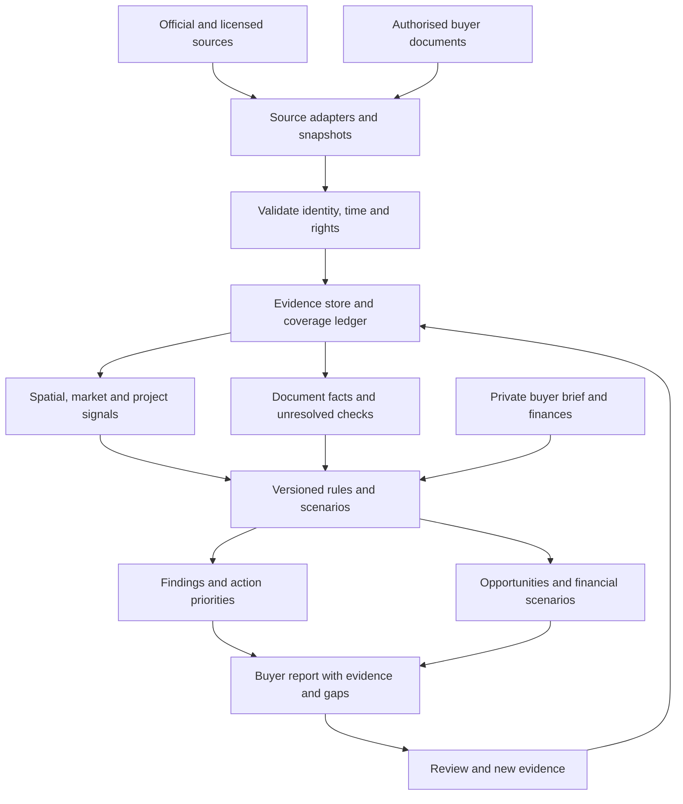

# Property Risk Engine Architecture

## Inputs processing scoring and proof plan

Version 1.0  
21 November 2026  
Property data research  
Design specification for an ACT first implementation

## 1 Purpose and first principles

The engine connects evidence about a home, its surroundings and its market to the consequences for a particular buyer at a particular price. It produces a traceable assessment of material concerns, conditional opportunities, ownership costs and unresolved checks.

The recommended first release is an evidence and scenario service with explicit decision rules. Its numerical score measures the urgency of a buyer action. It does not claim a statistically calibrated probability of loss. Later loss or price models can be added after there is suitable historical evidence and a defensible validation result.

The core unit of assessment is a purchase case: **property identity + proposed price + buyer brief + assessment date + evidence versions**. A property evidence profile can be reused across buyers. Private finances, preferences and resulting assessments remain separate.

### Outcomes that define the model

| Buyer question | Consequence to assess | Useful output |
| --- | --- | --- |
| Can I keep paying for it | Repayment strain and cash shortfall | Monthly surplus and buffer under named scenarios |
| Could I face a large bill | Repair, remediation, uninsured damage or shared liability | Evidenced costs, cost ranges and unresolved investigations |
| Can I use it as intended | Legal, physical or planning constraint | Requirement conflicts and specialist checks |
| Will it work for daily life | Access, sunlight, noise, safety and disruption | Current fit and likely changes during ownership |
| Could I struggle to sell | Thin buyer demand, unusual property, competing supply or finance restrictions | Resale concerns and relevant comparable evidence |
| What could improve | Access, services, feasible improvement or relative scarcity | Conditional benefits with milestones and dependencies |

These outcomes prevent a long list of datasets becoming an unexplained score. A nearby development becomes relevant through its possible effects on sunlight, privacy, access, competing supply or amenity.

### Principles that constrain every module

1. Preserve the difference between a hazard, actual exposure, building vulnerability and financial consequence.
2. Preserve the difference between a verified fact, a rule-derived finding, a scenario and a model estimate.
3. Keep downside, opportunity, buyer fit and evidence coverage separate.
4. Missing or failed data is not a zero-risk observation.
5. Match every conclusion to the geographical and temporal detail its source supports.
6. Trace every material finding to identified evidence and a versioned rule; state how fully retention rights allow it to be reproduced.
7. Preserve the highest material concern when aggregating. Positive amenities cannot erase it.

## 2 Product scope and assumptions

The first geography is the ACT. Detached houses are the primary proof cohort, with a small set of townhouses and apartments to test unit, building and common-property relationships. Other jurisdictions need their own source contracts, legal mappings and coverage tests before activation.

The architecture is compatible with a Bronze, Silver and Gold data pipeline. Bronze retains permitted raw evidence, Silver holds validated observations, and Gold holds reusable derived signals and assessment outputs. Integration with an existing repository remains a Stage 0 task because the current code and live database have not been inspected for this design.

### Assessment modes

| Mode | Minimum input | Available output | Visible limitation |
| --- | --- | --- | --- |
| Public evidence screen | Resolved address, property type and assessment date | Mapped exposure, local change, available market context and missing checks | Building condition, title interpretation, insurance and personal finance may remain unassessed |
| Buyer assessment | Screen plus buyer brief, price, relevant documents and quotes | Personalised action priorities, requirements conflicts and ownership scenarios | Conclusions retain inspection, document and source limitations |
| Historical model research | Time-stamped historical evidence and independently observed outcomes | Evaluation of a particular probability, cost or price model | Separate model approval and out-of-sample evidence required |

An assessment can be delivered with incomplete evidence, provided its scope and missing checks are prominent. The report must not be labelled complete because the automated job finished. Report public-screen completion and full due-diligence coverage separately. A public-only mode does not make building, title, drainage or insurance checks inapplicable; it leaves those applicable checks unassessed.

### Explicit design assumptions

- The service supports a buyer or their authorised adviser. It does not approve a loan or certify engineering or legal compliance.
- Buyer financial input is optional. Without it, financial resilience is not assessed.
- Public access and permission to redistribute are checked separately for every source.
- A small CPU-based deployment is sufficient for the initial rules, spatial joins and financial calculations. Document extraction may use a hosted model behind a provider-neutral interface.
- Access to paid property data, legal records, registered climate downloads and transport developer keys is a dependency to resolve, not an access capability assumed to exist.
- All thresholds in the first workflow are stated design policies. No historical calibration or production performance is claimed.

## 3 Inputs required from the buyer

The interface should request only the information needed for the selected mode, then ask for missing evidence when it changes a material finding.

| Input group | Fields and units | Required when |
| --- | --- | --- |
| Property identity | Address, unit where relevant, selected parcel/building candidate, property type | Every assessment |
| Purchase context | Proposed price in AUD, expected purchase date, owner-occupier or investor, intended holding period in years | Price context and personalisation |
| Intended use | Occupy, rent, renovate, extend, add dwelling or subdivide; exact non-negotiables | Use and planning assessment |
| Daily needs | Destinations, travel modes, maximum acceptable journey, access requirements, sunlight/noise preferences | Buyer fit assessment |
| Financing | Loan principal, annual rate as decimal, term in months, repayment type, fixed expiry and relevant fees | Finance scenarios |
| Purchase funding | Confirmed loan availability and conditions, cash allocated to purchase, acquisition costs and committed immediate works; reserve cash allocated separately | Funding sufficiency check |
| Household budget | Monthly net income, essential living costs, other debt payments, cash after settlement, protected reserve, minimum surplus and whether planned drawdown is allowed | Cash-flow resilience |
| Scenario tolerance | Named shocks, start and duration in months, planning horizon and essential reserve/no-drawdown requirements | Financial action priorities |
| Property costs | Annual rates, insurance, recurring maintenance, water/service charges, applicable tax, shared levies | Ownership cost assessment |
| Investment inputs | Weekly achievable rent, vacancy assumption, management costs and capital works | Rental scenarios |
| Evidence uploads | Contract/title/lease, inspections, plans, insurance quotes, repair quotes and relevant strata records | Document-dependent checks |

Income and cash fields need explicit consent, account-level access controls and retention choices. The public property profile must never contain a buyer's income, finance application or uploaded identity documents.

## 4 Architecture overview

The system has one assessment API and one background worker using the same application code. A PostgreSQL database with PostGIS stores spatial and structured evidence. Object storage holds permitted original files and generated reports. A scheduler starts source refresh jobs. The existing product interface consumes the assessment API.

The worker has distinct modules for acquisition, validation, identity matching, spatial and time joins, signal generation, scoring, document extraction and report assembly. These are modules within one deployable application initially. Each has a documented input/output contract so it can be separated later if measurements justify it.

### Processing sequence

1. Resolve the address and require confirmation if parcel, unit or building identity is ambiguous.
2. Determine applicable checks from geography, property type and intended use; record which the requested mode can execute without shrinking the full-profile denominator.
3. Select allowed evidence sources and versions available by the assessment date.
4. Acquire missing evidence or reuse a valid snapshot. Record failures and coverage explicitly.
5. Validate schemas, dates, units, geometry, duplication and permissions before normalising.
6. Join observations to the correct property, building, surrounding projects and market area.
7. Calculate signals and financial scenarios with deterministic code.
8. Apply versioned finding rules, evidence gates and buyer requirements.
9. Assemble structured findings, source references, maps and a concise buyer report.
10. Publish an immutable assessment version. Subsequent evidence produces a new version and a change explanation.

## 5 Sources and acquisition contracts

The register uses delivery labels V0 core, V1 extended and V2 optional. These prioritise the intended product releases; they are separate from the implementation Stages 0 to 6 in section 14. A V0 label does not imply that access is already operational. Source phases without an assigned release are selected during Stage 0 against the applicable signal catalogue.

The companion workbook is the implementation register. It identifies each source, exact verified access route, geography, publication pattern, recommended polling, permissions, verification level, limitations and fallback. An endpoint check confirms only the response observed during research. It does not prove sustained availability or complete coverage.

### Acquisition classes

| Class | Typical sources | Adapter behaviour |
| --- | --- | --- |
| Queryable public API | ACTmapi addresses, blocks, units, flood extent, bushfire areas and zoning | Read metadata, pin layer/schema, make bounded queries and page through results safely |
| Structured public download | RBA CSVs, ABS spreadsheets/CSV packages, ACT crime workbooks | Preserve file hash and workbook/table version; parse source identifiers and multi-row metadata |
| Authenticated or registered access | Transport Canberra developer feeds and registered climate downloads | Use approved service credentials; preserve access scope and licence terms |
| Public register and documents | DAs, planning amendments, infrastructure and land releases | Resolve records, preserve document versions, extract structured facts with source locations |
| Commercial feed | Licensed sales, listing, rental, property or hazard data | Contract-specific connector, usage metering and downstream display controls |
| Private case evidence | Inspection, title/lease, insurance and repair documents | Authorised upload, safe processing and case-scoped evidence retention |

### Findings that materially change the implementation

**ACT spatial services are a workable starting point.** Bounded reads returned data from address, block, unit, flood-extent, bushfire and zoning services. Use the actual hosted layer identifiers in the source register; the zoning layer is layer 1. Address or parcel geometry is not automatically a dwelling footprint. [H02-H03, H07, H09, P01]

**Flood depth requires a separate acquisition decision.** The identified depth and hazard products are tiled map services. Their metadata does not establish access to numeric depth values suitable for an automated property-loss calculation. The first release can screen mapped extent and surface a request for more detailed evidence. It must not derive precise depth from a rendered map's colours. [H07-H08]

The checked ACT flood products do not cover every flooding mechanism. Their published limitations exclude overland flow, pipe bursts and lake/dam overflows. A successful non-intersection answers only the particular mapped 1 percent annual exceedance probability screening question. Local drainage and overland-flow evidence remain separate required checks. [H07-H08]

**The ACT crime catalogue entry is a file asset.** The reviewed legacy entry contains an XLSX download rather than row-level Socrata columns. Use the current ACT Policing downloads when more recent and preserve the reference period. [P15]

**Current transport feeds need approved developer access.** Older public endpoints are marked deprecated. The official replacement describes developer registration and authentication. A straight-line distance may be shown as such while routing data is unavailable; it must not be labelled walking time. [P16]

**ABS needs both API and download adapters.** The API is documented, but an attempted metadata request in this research returned 503. Official XLSX/CSV downloads provide a practical fallback. Preserve the geography and publication lag of each series. [P08-P14]

**RBA F1 and F6 are verified CSV downloads.** Both returned HTTP 200 and expected table headers in bounded reads. Their files contain metadata rows as well as observations. Identify series by published identifiers rather than fixed column positions. A reported percentage must be converted explicitly before use in loan arithmetic. [R01-R02]

**Public data cannot complete the property assessment.** Inspection, insurance, title and relevant building-file evidence remain separate inputs. ACT building-file access requires ownership or owner authorisation; the contaminated-sites register is explicitly incomplete. [H11-H16]

### Source contract fields

Each source contract contains source ID, publisher, official landing URL, endpoint or download discovery method, schema/version, authentication method, licence URL and allowed uses, spatial coverage, observation frequency, publication schedule, expected delays, last successful check, last observed publication, rate limit, pagination method, stable record key, parser version, freshness policy and fallback.

Publication frequency and polling frequency are different. A daily check of an annual source does not create daily observations. A long-standing map is not automatically invalid because its publication date is old; retain both model vintage and confirmation that it remains the current published layer.

### Recommended refresh policy

| Source family | Suggested checking pattern | What triggers recalculation |
| --- | --- | --- |
| Address and cadastral layers | Daily metadata checks, changed snapshots | Identity, boundary or unit relationship changes |
| DAs and plan amendments | Daily for monitored locations | New version, changed status, conditions or geometry |
| Infrastructure | Weekly, daily for active nearby milestones | Funding, approval, route, timing or scope changes |
| Land release programmes | Monthly and Budget/release events | New programme, yield, timing or servicing changes |
| RBA | Business-day check of F1, release-aware F6 check | New observation or revision relevant to a scenario |
| ABS and crime | Release-aware polling | New period, revision or boundary change |
| Hazard and climate maps | Monthly metadata checks and announced revisions | New model, scenario, coverage or official designation |
| Quotes and inspections | On upload and before a material decision | New evidence, expiry or changed property condition |

These are proposed operational settings, subject to provider limits and observed source behaviour. No scheduled collection has been started as part of this design.

## 6 Data model and evidence storage

### The three evidence layers

**Bronze** stores acquisition records and immutable originals where permission permits: JSON, CSV, spreadsheets, PDFs and metadata. Each has a content hash, retrieval details and retention policy. When storage is restricted, keep permitted identifiers and derived information with a record of the restriction.

**Silver** stores validated typed observations, identities, geometries, project milestones and document facts. Original values and units remain available beside normalised values. Conflicting observations remain distinct.

**Gold** stores reusable property signals and immutable case assessments. Derived outputs inherit the most restrictive applicable permission of their inputs. A property-level subject does not make an observation public. A private inspection-derived signal remains private; promotion to shared evidence requires a separate authorised release decision.

Expose the permitted replay level: **FULL_REPLAY** retains the original inputs and transformations; **DERIVED_REPLAY** reproduces the calculation from retained validated observations but limits original-source reinspection; **METADATA_ONLY** retains permitted identifiers and hashes without promising full recreation. Apply current licence and retention obligations when retrieving historical assessments.

### Core entities

| Entity | Main content | Relationship or constraint |
| --- | --- | --- |
| Property | Canonical property ID, addresses, type and identity status | One property can relate to multiple parcels and buildings |
| Parcel and building | Source IDs, geometry, coordinate reference, positional accuracy and valid dates | Preserve many-to-many links and common property |
| Source and snapshot | Contract, version, hash, retrieval result, observation period and rights | Every observation refers to a specific snapshot |
| Observation | Subject, field, original/normalised value, unit, source location and evidence type | Keep contradictory values; never silently overwrite |
| Coverage | Source extent, periods, exclusions, freshness and acquisition state | Required to interpret an empty result |
| Project and milestone | DA/infrastructure identity, geometry, status events and version links | Separate funding, approvals, contracts and construction |
| Spatial relation | Property/project/layer relation, distance, overlap, method and uncertainty | Store parcel, building and route findings separately |
| Signal | Feature value, supporting observations, transformation and version | Reusable only within applicable geography/time/rights |
| Buyer case | Brief, price, private finances, requirements and consent | Tenant-scoped; no public property-row embedding |
| Finding | Triggered rule, consequence, priority, evidence state, timing and action | Traceable to signals and case requirements |
| Assessment run | Input versions, rule version, status, outputs and prior run | Immutable; a rerun creates a new assessment version |
| Review and audit | Reviewer, decision, reason, supporting evidence and timestamp | Append-only correction history; original remains traceable |

### Minimum observation record

Every observation must identify what was measured, where, when, by whom and under which limits. Required fields are `observation_id`, `source_id`, `snapshot_id`, `subject_id`, `field_key`, `value`, `unit`, `geometry_reference`, `valid_from`, `valid_to`, `published_at`, `received_at`, `retrieved_at`, `evidence_type`, `source_locator`, `quality_flags` and `rights_policy_id`. Unknown dates remain null with a reason.

Snapshots, observations, signals and findings carry `owner_tenant_id`, `case_scope_id` where relevant, `visibility_scope` and `rights_policy_id`, directly or through an enforced inherited policy. Shared public data uses an explicitly public scope. Private evidence uses the authorised tenant/case scope.

The source locator can be a feature ID, document page and section, spreadsheet sheet/cell, or published series identifier. An acquisition timestamp cannot substitute for a missing publication date.

## 7 Processing and analytical modules

### Identity and spatial processing

Resolve official address and parcel identifiers before enrichment. Keep aliases and address changes. Require unit-level confirmation when several units share a coordinate. An approximate match can produce a candidate list, but cannot silently assign building-specific hazards or title conditions.

Retain the original coordinate reference system and transform into a suitable metric system for distances and areas. Confirm coordinate and vertical datums before comparing floor heights with flood or terrain elevation. Standard PostGIS intersection and distance functions are suitable building blocks; their units and coordinate requirements are documented by the project. [T01-T02]

Test coverage first, then intersection. Distinguish positive-area overlap, boundary contact, non-overlap and indeterminate alignment. Boundary contact or uncertain alignment creates a spatial-review gap, not an unqualified exposure finding. If a parcel does not overlap a flood polygon, report the result within that map's scope. If a building footprint or coverage boundary is missing, preserve that gap. Features close to a boundary within known positional uncertainty enter review rather than being classified with false precision. [T01, T05]

Use proximity to retrieve candidate projects. Evaluate their effect using relevant geometry, elevation, orientation, route access and use. A common radius is not an impact model. Shadow conclusions require adequate proposed geometry or reliable shadow documentation.

### Time and version processing

Maintain event/effective time, publication time and ingestion time. Historical assessments may use only information available to the authorised assessment party by the assessment cut-off. Store publication/effective dates and the date private evidence was received; later discoveries cannot silently enter a historical assessment. Unknown first-publication time prevents a claim of faithful historical replay unless availability is independently established. A future project announced before the cut-off remains valid evidence of a future proposal.

Historical joins use property, parcel and geography versions valid for that context. Keep corrections and superseded versions, subject to rights, and state the achievable replay level.

Geographical boundaries also change. Census, population, crime and housing series need the geography version, with a documented correspondence if compared across boundaries. Never allocate territory totals equally across suburbs and present the results as observations.

### Data validation and reconciliation

Validate required fields, data types, units, periods, geometry and expected schema. Quarantine unexpected structural changes rather than returning an apparently clean empty dataset. Preserve the last valid snapshot with its actual age when a source is temporarily unavailable.

Treat zero, absent, unavailable, not applicable and not assessed as distinct states. An empty API result is meaningful only when the query, source coverage, period and successful retrieval are established.

Use authority and applicability by field. The relevant legal instrument governs legal status; the latest valid decision governs a DA determination; a property inspection governs what that inspection actually observed. A recent marketing description does not overwrite an older authoritative document without reconciliation. Record material conflicts for review.

### Hazard and property condition

The first hazard outputs are exposure statements and investigation actions. Preserve any official hazard category in its original scale. An overlay designation does not provide a property-specific annual damage probability.

Model financial consequences only when both the hazard and asset data support them. A future expected-loss module would require appropriate event probabilities, intensity/depth information, asset vulnerability, replacement values, damage functions and treatment of insurance. Rare severe losses should remain visible alongside expected annual loss.

Building and strata modules extract dated findings, inspection scope, exclusions, recommended actions and cost evidence. Photos can support observations; they cannot establish the absence of concealed defects. Repair costs require a quote or a clearly identified estimate with a range and assumptions.

### Development and infrastructure

Represent the project as a canonical entity with multiple milestones, rather than a single fixed sequence. Funding can precede or follow an approval. Capture cancellation, deferral, changed scope and dependencies.

For each property, calculate or describe access changes, construction exposure, sunlight/privacy concerns and competing supply. A documented project milestone may be high-confidence evidence while its price effect remains unassessed.

Opportunity ranking uses verified delivery evidence, a meaningful benefit to this buyer, timing and unresolved dependencies. It never subtracts from risk. A monetary uplift is only shown if a separately validated valuation method supports it.

An announced improvement may already be reflected in the current asking or sale price. Assess its net effect alongside construction disruption, noise, route access and competing supply; proximity alone cannot establish an additional future premium. Scarcity is potentially useful only where comparable homes face sustained effective demand. Keep these as explicit analytical questions until evidence supports a monetary conclusion.

### Supply and demand

Define the relevant market using comparable dwelling type, size, price band and realistic substitute locations. Include cross-border alternatives when the buyer would genuinely consider them.

Count existing stock, active listings and pipeline stages separately. Link land releases, DAs, building approvals and construction updates to one canonical development so the same homes are not counted repeatedly. Distinguish net additions from replacement/demolition activity and from listing turnover.

Building approvals, commencements and completions have different meanings and geographical availability. ABS state-level completions do not establish the completed supply in one suburb. [P08-P09]

Until historical stage-to-completion rates have been estimated, present explicit low/base/high delivery scenarios chosen and recorded by the analyst. Do not attach invented probability weights to each planning stage.

Compare supply with household formation, purchasing capacity, rental demand and employment. Population change alone does not equal the number of additional homes required. Rental bond lodgements/refunds can be useful context where available, but are not a direct vacancy measure. [R04]

### Price and resale context

Use relevant settled transactions with provenance, date, type, size, condition and meaningful differences. Show the selected comparable set and why each was included. Ask-price history and an automated valuation are supporting observations, not independent proof of value.

Do not treat an automated valuation influenced by the current asking price as independent evidence that the asking price is correct. Preserve known dependencies between data sources and derived estimates.

A first-release price assessment should describe evidence, range and missing comparables. An insufficient comparable set returns an unavailable conclusion. Price-growth forecasting is a later, separately evaluated module.

### Crime and liveability

Retain offence categories, observation periods, counts and reporting caveats. Use a valid denominator for each comparison and label its limitations. Changes from very small counts should be reported as counts rather than dramatic percentage claims. No suburb statistic should be presented as the probability of an offence at the exact house. [P15]

Measure actual journey time only when routing/network inputs support it. Keep current amenity distinct from future promised service. Use recorded outcomes and service characteristics; protected demographic characteristics must not serve as neighbourhood risk proxies.

### Financial scenarios

Use the buyer's actual loan terms when supplied. RBA series provide context. Store rates internally as decimal annual rates and distinguish a percentage-point increase from a percentage increase. [R01-R02]

For a standard fully amortising loan, monthly payment is defined in the mathematical specification below. For a zero rate, payment is principal divided by the number of months. Interest-only loans, fixed-rate changes and offsets require their own explicit cash-flow treatment.

$$
M = \frac{P r}{1-(1+r)^{-n}}
$$

Here P is principal, r is the annual decimal interest rate divided by 12, and n is the remaining monthly payment count. The calculation assumes a constant rate and regular monthly periods. It does not reproduce every lender's daily interest, fee or offset convention.

Calculate monthly surplus as net household income plus rental receipts, less living costs, other debt payments, mortgage payments and property costs. For investors, start with scheduled gross rent, deduct the specified vacancy allowance and management fees once, then itemise the remaining ownership expenses separately. State that the initial rental illustration is before personal income tax; tax effects require an explicit additional module. Cash after settlement must already allow for acquisition costs and committed upfront work. Keep recurring maintenance allowances separate from one-off repairs to prevent double counting.

For constant negative surplus, simple buffer duration is available cash divided by monthly deficit. If a protected reserve is specified, also show duration until that reserve is reached. Every stress has a start and `scenario_duration_months`. A reserve breach occurs when projected cash falls below the protected reserve during the stated scenario/planning horizon. Planned drawdown is not automatically a requirement conflict. For variable cash flows or shocks, calculate a monthly balance schedule instead of using the simple ratio. Non-negative surplus returns no depletion under the specified assumptions, not an assertion of unlimited financial safety.

Initial scenarios vary rate, income, vacancy, repair cost and insurance. These are conditional calculations. Their parameters and any joint shocks remain visible; no likelihood is implied without a calibrated model. Defer net resale proceeds and total-return forecasts from the first release. A later exit model must subtract outstanding loan principal at the sale date, selling costs and applicable exit costs, with any taxes explicitly treated; subtracting the original loan principal is incorrect.

## 8 Scoring specification

### Three independent dimensions

Each result carries **assessment state**, **action priority** and **evidence confidence**. Financial consequences and project status are additional fields, not hidden multipliers.

| Dimension | Allowed values | Meaning |
| --- | --- | --- |
| Assessment state | ASSESSED, NOT_ASSESSED, NOT_APPLICABLE | Whether a particular check has enough applicable evidence to answer; separate reasons include INSUFFICIENT, CONFLICTED and OUTSIDE_COVERAGE |
| Action priority | 0, 1, 2, 3, 4, or null | Urgency under the explicit policy below; null for an unassessed substantive finding |
| Evidence confidence | High, Medium, Low, Unknown | Strength of support for this specific claim |
| Evidence basis | Official record, inspected observation, buyer input, derived rule, model estimate, scenario | How the statement was produced |

Confidence is claim-specific. A current official map can support a high-confidence statement that a block intersects a designation, while the dwelling's loss risk remains unassessed. Confidence is never multiplied into a risk score to reduce a serious but uncertain concern.

### Action priority policy

| Priority | Label | Trigger and required response |
| --- | --- | --- |
| 0 | No flag in assessed scope | Applicable checks are sufficiently assessed and no rule triggers a concern. Show the scope explicitly. |
| 1 | Monitor | A relevant future change or minor concern does not currently require a purchase-stage decision. State the event to watch. |
| 2 | Review or budget | Evidence supports a relevant issue that requires checking, costing or allowance before the buyer finalises their position. |
| 3 | Resolve before commitment | A potentially material exposure, conflicting evidence or missing critical check could change the buying decision. Obtain specific evidence or specialist review. |
| 4 | Confirmed requirement conflict | Verified evidence conflicts with a stated non-negotiable, including an essential no-drawdown or reserve requirement under declared conditions. Resolve the conflict or revise the buyer's plan. It is not an automatic legal prohibition on purchase. |
| null | Not assessed | Required evidence is absent or unusable. Create a separate investigation task with its own action priority. |

These priorities encode a review workflow. They are not probabilities, legal classifications or empirically estimated price discounts. Initial priority thresholds must be reviewed by the relevant domain specialists and tested against the proof cohort.

### Aggregation and precedence

1. Evaluate applicability using property type, jurisdiction and buyer requirements. Assessment mode controls executable scope, not the full-profile check denominator.
2. Check identity, source availability, rights, coverage, date, precision and required inputs.
3. If a prerequisite is insufficient, set the substantive check to NOT_ASSESSED with a reason, leave its finding priority null and create a gap task. A missing critical check receives gap priority 3 under this proposed workflow.
4. Otherwise evaluate the versioned rule and retain the observations that caused it to fire.
5. For each domain, take the maximum priority of assessed findings. Store this separately from the maximum gap-task priority.
6. Workflow priority is the maximum of finding and gap priorities. A domain containing only gaps has no assessed-risk priority.
7. A profile is complete only when every required applicable check is sufficiently assessed. Missing non-critical checks also make coverage incomplete; critical gaps add their defined investigation priority. An overall highest finding may still be displayed, clearly labelled as partial.
8. Opportunities and preferences are shown separately and never enter this maximum calculation as negative values.

Publish the highest concern, number of material findings and critical unresolved checks. Do not average a severe condition across many benign attributes. Related indicators share a causal family so they are not presented as independent corroborating evidence.

### Coverage and confidence policy

Coverage is the number of required applicable checks with sufficient evidence divided by the number of required applicable checks. A zero denominator returns null with a reason. Freeze the check catalogue for an assessment version. An irrelevant check can be excluded only with a recorded applicability reason. Unavailable evidence remains in the applicable denominator. Expanding one easy check into many small checks must not inflate reported completeness.

Show critical-check completion separately. A profile with 19 of 20 checks complete can remain incomplete because the missing check is critical. Coverage percentage is not model accuracy or certainty.

High confidence requires an authoritative or well-supported source, current applicability, adequate precision and no material unresolved conflict. Medium means useful but qualified support. Low means indirect, coarse, stale or materially assumption-dependent evidence. Unknown means insufficient evidence. For derived findings, confidence cannot exceed the weakest necessary supporting observation; multiple dependent copies of one source do not raise it.

### Example rule specifications

| Rule | Condition | Finding or gap | Action |
| --- | --- | --- | --- |
| ID01 | Unit, parcel or building match is ambiguous | Identity insufficient; dependent conclusions withheld | Gap priority 3; confirm identity |
| FL01 | Verified positive-area parcel overlap with an official flood extent, outside alignment uncertainty | Mapped exposure, not a damage probability | Provisional priority 3; obtain dwelling/drainage and insurance evidence; reassess action after review |
| FL02 | Flood screen does not intersect, but source coverage is missing | Flood assessment not assessed | Gap priority 3; establish coverage |
| FI01 | Verified positive-area bushfire designation overlap on relevant land | Official designation recorded | Provisional priority 3; inspect building/insurance implications and reassess after review |
| BD01 | Inspection identifies a material defect; cost unresolved | Material cost uncertainty | Priority 3; obtain scoped quotation or specialist report |
| LG01 | Verified restriction conflicts with declared intended use | Confirmed buyer requirement conflict | Priority 4; specialist confirmation and plan revision |
| IN01 | Quote terms conflict with the buyer's stated required cover | Confirmed cover conflict within reviewed quote scope | Priority 4; resolve cover or revise requirement |
| DV01 | A relevant northern proposal exists; sunlight impact unverified | Potential amenity issue with an evidence gap | Priority 2 or 3 according to declared sunlight requirement |
| SP01 | Competing pipeline exists but completion evidence is insufficient | Conditional supply scenario | Priority 1 or 2; preserve stages, do not assert oversupply |
| FN01 | Baseline monthly cash flow is negative with complete inputs | Deficit under submitted assumptions | Priority 3; priority 4 only where it breaches an essential declared funding requirement |
| FN02 | Projected cash breaches the protected reserve within a named stress duration | Conditional resilience concern | Priority 3 for required stress review; priority 4 only for an explicit essential tolerance conflict |
| OP01 | Transport milestone and useful access improvement are supported | Conditional opportunity | Separate opportunity card; no risk offset or automatic value uplift |

The workbook expands these rules, their prerequisites and missing-data behaviour. FL01/FI01 priority 3 is a provisional due-diligence priority following a screening trigger, not intrinsic hazard severity. Once sufficient site-specific evidence is reviewed, retain the designation fact and reassess or close its investigation action. Configurable consequences such as repair-budget limits and minimum cash reserves belong in the buyer brief or visible policy configuration, not hidden constants.

## 9 Output contract and report

### Buyer report structure

The first page answers: what requires action, what it could mean for this buyer, what is still unknown, and what to do next. Further sections provide ownership scenarios, changes around the property, conditional opportunities, buyer fit and the evidence ledger.

Every material card includes the finding, affected outcome, action priority, evidence confidence, relevant time window, source date and link, limitations, requested next action and reviewer status. Facts and interpretations must be visually distinguishable without making the reader open the raw data.

The report can include a map of the actual parcel/building and relevant overlays, but the structured findings remain usable without the map. An assessment-level timestamp must not conceal that individual sources have different observation dates.

### Proposed service boundary

| Route | Purpose | Important behaviour |
| --- | --- | --- |
| POST /v1/property-resolutions | Resolve an address | Return candidates and match quality; require confirmation when ambiguous |
| POST /v1/cases | Create buyer context | Private, authorised, versioned inputs |
| POST /v1/cases/{id}/documents | Register authorised evidence upload | Validate file type/size and process asynchronously |
| POST /v1/assessments | Request a dated assessment | Return job ID; require idempotency key; pin input and rule versions |
| GET /v1/assessments/{id} | Fetch structured result | Include status, domain priorities, coverage and source lineage |
| GET /v1/assessments/{id}/report | Retrieve rendered report | Respect evidence display permissions and case authorisation |
| GET /v1/assessments/{id}/changes | Explain differences from prior run | Separate source, buyer-input and rule changes |
| POST /v1/findings/{id}/reviews | Record a review decision | Append reason/evidence; preserve original finding |
| GET /v1/source-health | Support operations | Authorised operational view; no secrets or private buyer data |

These routes are proposed contracts. No server or collector has been implemented.

### Result fields

The response includes `assessment_id`, `case_id`, `property_id`, `as_of`, `generated_at`, `status`, `assessment_mode`, `rule_version`, `input_snapshot_ids`, `domains`, `findings`, `gap_tasks`, `opportunities`, `financial_scenarios`, `screen_completion`, `full_profile_coverage`, `critical_gaps`, `replay_level`, `limitations`, `review_state` and `prior_assessment_id`.

A domain contains `assessed_priority`, `gap_priority`, `workflow_priority`, `assessment_state`, `required_check_count`, `sufficient_check_count` and the IDs of its findings and gaps. All scores carry the policy version. Null values are preserved as nulls with reasons.

Jobs use queued, running, needs_input, completed, completed_with_gaps and failed states. Failure of one source should not erase valid unrelated findings. A failed identity match prevents downstream property-specific assessment.

## 10 Worked example of the proposed behaviour

This is an explicitly hypothetical purchase case used to explain the design. It is not an assessment of a real address or a prediction of mortgage rates.

Assume a buyer proposes a A$900,000 house purchase with a A$720,000 loan over 30 years. Net household income is A$11,000 a month; essential living and other debt costs are A$4,800; recurring property costs are A$900. Cash after settlement and committed costs is A$45,000. The buyer specifies a protected reserve of A$15,000 and asks to review a 12-month combined stress before committing; this is a review requirement, not an essential no-drawdown condition.

| Scenario | Monthly payment | Monthly surplus or deficit | Cash consequence |
| --- | --- | --- | --- |
| Base at 6 percent | A$4,316.76 | A$983.24 surplus | No depletion under these fixed assumptions |
| Rate at 8 percent | A$5,283.10 | A$16.90 surplus | Almost no monthly room for additional expenses |
| Rate at 8 percent and income down 30 percent for 12 months | A$5,283.10 | A$3,283.10 deficit | About 9.14 months until the protected reserve; cash after month 12 is A$5,602.74 |

FN02 gives the 12-month combined stress priority 3 under the declared review policy. A six-month version leaves A$25,301.37 and does not breach the A$15,000 reserve. A continuous extension of the same deficit would deplete all cash after about 13.71 months. These simple durations assume constant monthly flows; the engine retains unrounded values internally and shows actual monthly balances.

Now add hypothetical evidence: a verified flood-extent intersection on the parcel, no dwelling-floor/drainage assessment, a material roof defect with no quotation, and a documented future transit project with opening later in the buyer's holding period.

The report shows mapped exposure at action priority 3, separate critical gaps for flood consequence and roof cost, and the conditional transport opportunity. It shows the financial scenarios with their assumptions. It does not reduce the flood or roof concern because transport access may improve. Overall assessment status is completed_with_gaps, with resolve-before-commitment workflow priority and no complete property-risk grade.

Suppose 14 of 20 required checks are sufficiently assessed. Coverage is 70 percent; the remaining six checks are listed, including the critical ones. That percentage says nothing about the chance the property is safe or will appreciate.

The next useful evidence is a scoped inspection or assessment, a repair quote and appropriate insurance terms. Reassessment must show exactly which findings changed and why.

## 11 Technology selection and reuse

### Recommended composition

| Component | Recommended approach | Reason |
| --- | --- | --- |
| Structured and spatial storage | PostgreSQL with PostGIS | One store for identities, relationships, evidence and spatial joins |
| Service and worker | Python application, FastAPI interface, strict validated models | Clear contracts and shared analytical modules; existing project equivalents can be retained |
| Acquisition | Source-specific HTTP/download/document adapters | Each source has different semantics, rights and update behaviour |
| Original evidence | Existing object storage with hashes and access controls | Reproducible snapshots without large binary files in relational rows |
| Scheduling | Existing scheduler invoking a retry-safe worker | Adequate for the initial batch workload |
| Job control | Durable job records and a proven queue/worker mechanism already in the stack where available | Jobs survive service restarts; idempotency prevents duplicate work |
| Document extraction | Text extraction first, OCR when needed, schema-constrained LLM extraction | Preserve page references and validate facts before rules consume them |
| Interface | Existing property product consuming structured assessments | Avoid duplicating the whole product |
| Reporting | HTML/PDF generated from the same structured assessment | Keep the report consistent with the API result |

PostGIS provides indexed intersection and distance operations. Strict validation libraries can reject unintended type coercion. FastAPI is a documented service option; its lightweight background tasks are not the proposed persistence mechanism for long-running assessment jobs. [T01-T04]

### Reuse options assessed

**Direct official sources** are the primary ACT route: they retain original semantics and can support a small proof without assuming a commercial data contract. They need several adapter types and visible gaps.

**Licensed property data** is a complementary option for transaction, listing, rental or hazard gaps. Cotality advertises API and bulk access, but fields, retention, historical coverage, costs and downstream rights require a product-specific agreement. [R03]

**Planning aggregation** can reduce jurisdictional adapter work when expansion warrants it. Current ACT freshness, coverage, commercial terms and links to original determinations must be verified before adoption. The initial ACT proof can use the official register and document workflow.

**Existing project components** should be retained wherever they satisfy these contracts. Stage 0 compares the proposed modules against the repository, database, collectors and deployment environment before selecting packages or creating migrations.

The first runtime does not require a dedicated GPU. The numerical and spatial workload should be benchmarked on CPU before allocating hardware. Hosted model use should be limited to documents where deterministic extraction is inadequate, with per-case cost limits.

## 12 Operation security and governance

### Reliability and performance

Use idempotency keys and uniqueness constraints for snapshots, source records and assessment requests. Retry transient failures with bounded backoff. Do not retry invalid credentials or changed schemas indefinitely. Record failures in source health and expose their effect on coverage.

Cache reusable property signals by evidence, transformation version and the relevant tenant/case/visibility-policy scope. Recompute only dependent signals after a change. Keep a dependency graph in metadata, without requiring a separate graph database. Pin a coherent snapshot set for each assessment so a report cannot mix changing inputs mid-run.

Operational measures include source freshness, successful/failed acquisition, quarantined rows, unresolved identities, critical gaps, extraction rejection, assessment latency, cost per case and reviewer amendments. Initial performance targets are hypotheses to benchmark: a cached public screen within 60 seconds and an ordinary document-backed case within five minutes, excluding external access and human review.

### Evidence rights and private information

Store source rights for collection, retention, derived use, commercial use, raw display and redistribution separately. A publicly accessible endpoint does not settle these rights. The report renderer must enforce the permitted display mode. A restricted document may support a permitted derived finding without being redistributed in full.

Separate tenant-private buyer records and uploads from reusable property observations. Apply least-privilege access, encrypted transport/storage, scoped download links, consent and deletion controls. Avoid personal names or addresses in ordinary operational logs where case IDs suffice. Record access to private evidence and administrative changes.

Treat all acquired documents as untrusted content. Their text cannot issue instructions to tools, change scoring rules or authorise external actions. Limit file sizes, parser time and model tokens; isolate document parsing; validate model outputs against an explicit schema. Source references and structured facts must pass validation before publication.

### Review responsibility

Data owners approve source contracts and parser changes. Domain reviewers approve initial rules and material changes to legal, building, hazard and insurance interpretations. Product owners approve scope and wording. Engineers verify reproducibility and operational behaviour. Reviews append evidence and reasons, with changes linked to the affected assessment.

A rules release should include its rationale, changed thresholds, expected affected cases, test results and rollback version. Buyer-facing assessments must retain the version they originally used.

## 13 Proof and validation plan

### Technical proof cohort

Use 30 ACT properties: 20 detached houses, five townhouses and five apartments. Deliberately include known mapped exposure, nearby development, incomplete documents, uncertain identity, conflicting data and relatively uncomplicated cases. This is a proposed diagnostic cohort, not a statistically representative sample of ACT housing.

Freeze source snapshots and independent reference findings. A reviewer should establish the reference assessment before seeing the engine output. Keep synthetic edge cases separate from real-property cases.

### Initial acceptance criteria

| Area | Required proof |
| --- | --- |
| Identity | Every case matches the intended property or explicitly requests confirmation; no silent wrong-unit acceptance |
| Traceability | Every material finding links to exact evidence, transformation and rule version |
| Missingness | Missing, failed, stale and out-of-coverage sources never produce a false clean result |
| Scoring | Priority precedence, critical-gap handling and no upside offset are correct on all specified cases |
| Calculations | Independent verification of financial and spatial examples, units and boundary conditions |
| Project semantics | Proposed, funded, approved, commenced, operational and cancelled records remain distinct |
| Supply | The same development is not counted again at each pipeline stage |
| Time | Historical assessments cannot use information unavailable to the authorised party by their cut-off; future events already announced remain eligible evidence |
| Privacy and rights | Cross-case access and prohibited source redistribution fail the required tests |
| Reviewer value | Record missed material issues, false alerts, additional verified findings and research time per case |

The full acceptance register contains implementable test cases and expected results. All engine acceptance tests are planned; none is claimed as passed by this architecture exercise.

### Product value experiment

After the technical proof, test the buyer workflow with five buyers' agents over 20 properties each. Allocate comparable properties between baseline research and assisted research, randomise or counterbalance order, and record familiarity with each address. Avoid showing the engine report before the baseline is frozen.

Measure additional verified decision-relevant findings, minutes saved, missed issues, false alerts and whether a finding changes an inspection request, cost allowance, offer condition, price view or decision. Set commercial go/no-go thresholds before reviewing results. Demonstrating usefulness requires this task evidence; technical correctness alone does not establish buyer demand.

### Later predictive validation

Any probability or value model needs a named target, horizon, population and sufficient outcomes. Use chronological and geographic hold-outs, preserve publication lags, include withdrawn/delayed projects and report uncertainty. Assess calibration as well as ranking, and compare against a simple baseline. Rare flood/fire outcomes require more evidence than a small property trial can provide.

Potential later modules include expected insured/uninsured loss, probability of a specified ownership-cost threshold being exceeded, project delivery timing and conditional resale/rental models. Each is approved separately. A machine-learning model is not a prerequisite for the first proof.

## 14 Build sequence and completion gates

| Stage | Work package | Completion evidence |
| --- | --- | --- |
| 0 | Inspect existing repository and data; confirm scope, rights, credentials and source contracts | Integration map, source status and frozen proof cases |
| 1 | Identity, snapshots, coverage and canonical schema | Reproducible address-to-evidence path with missingness tests |
| 2 | Public spatial and local-change signals | Correct parcel joins, project statuses and documented source gaps |
| 3 | Buyer inputs, document extraction and financial scenarios | Validated extraction, consent boundaries and independently checked calculations |
| 4 | Scoring, API output, report and review workflow | Traceable findings with consistent priorities and visible coverage |
| 5 | Technical proof, adversarial cases and buyer-agent trial | Acceptance results, defect log and measured product value |
| 6 | Expand sources or introduce a predictive module | A demonstrated gap, verified data rights and separate evaluation plan |

Development estimates should be made after Stage 0 confirms the existing code, document workload and access dependencies. Paid licences and external approvals can dominate elapsed time and should be tracked separately from engineering effort.

The first end-to-end slice is one confirmed house, a small frozen source set, two named financial scenarios, a handful of material rules and a fully traceable report. Then expand to the diagnostic cohort. This sequence makes source and reasoning failures visible before adding breadth.

## 15 Decisions and outstanding dependencies

| Decision | Position in this design | What could change it |
| --- | --- | --- |
| Initial geography | ACT, with jurisdiction adapters | Verified national sources and local legal/source coverage |
| Scoring | Explicit 0 to 4 action priority; independent confidence and coverage | Calibrated outcome models with adequate validation |
| Data platform | Reuse Bronze/Silver/Gold and PostgreSQL/PostGIS where compatible | Repository inspection reveals a better established fit |
| AI role | Document extraction and evidence explanation | A separately proven analytical model for a defined outcome |
| Source route | Official APIs/downloads plus document evidence | Measured commercial-feed coverage benefit and suitable terms |
| Full property assessment | Requires private documents and property-specific checks | Verified sources that can legitimately satisfy specific checks |
| Deployment | Small CPU service and worker with durable storage | Measured concurrency, volume or availability requirements |

The material open dependencies are current repository integration, property-level sales/rental data rights, numeric flood-depth access, appropriate building geometry, registered transport/climate access, document permissions and specialist review of the first rules. These are recorded gaps rather than assumed capabilities.

**Design confidence is High for the overall separation of evidence, rules, buyer scenarios and outputs; Medium for source integration effort because only selected endpoints received bounded checks; and Low for property-specific loss probabilities or percentage price uplift until those models and inputs are validated.**

## 16 Glossary

| Term | Meaning in this design |
| --- | --- |
| API | A documented interface for software to request or submit data |
| Parcel | A legally defined land unit; not necessarily the dwelling footprint |
| Feature service | A spatial API returning map features and their attributes |
| Tiled map service | Pre-rendered map images; not proof that numerical underlying values are queryable |
| Hazard | A potentially damaging event or condition |
| Exposure | Whether the property, building or access route is affected by the hazard |
| Vulnerability | How susceptible the particular asset is to damage |
| Signal | A defined measurement or derived feature used by an assessment rule |
| Finding | An evidence-supported conclusion relevant to the buyer |
| Coverage | Which applicable checks can be sufficiently assessed |
| Action priority | The urgency of a buyer action under the stated workflow policy |
| Point in time | Only the evidence available by the specified assessment date |
| Idempotency | Repeating the same request does not create duplicate work or records |
| Calibration | Whether predicted probabilities agree with observed outcome frequencies |

## 17 Source references

The source IDs in this design match the companion workbook. Access evidence was checked on 21 November 2026. These references identify official sources and documented routes; the workbook records the more precise test status, access restrictions and fallbacks. Proposed signal and rule priorities are design choices, not provider classifications.

### Property identity hazards and private evidence

**H01 — Open G-NAF**  
Publisher: Geoscape Australia; Australian Government Department of Industry, Science and Resources. [Official source](https://www.industry.gov.au/publications/geocoded-national-address-file-g-naf-and-administrative-boundaries-ab-data).  
Access evidence: Official access documentation verified; download and CKAN metadata endpoints not successfully accessed

**H02 — ACTGOV ADDRESSES**  
Publisher: ACT Government / ACTmapi. [Official source](https://www.arcgis.com/home/item.html?id=13427dc77da340a29dd6601af4d7484d).  
Access evidence: Live metadata and anonymous query checked: HTTP 200, one feature returned; no full dataset downloaded

**H03 — ACTGOV BLOCKS and ACTGOV UNIT**  
Publisher: ACT Government / ACTmapi. [Official source](https://www.arcgis.com/home/item.html?id=802b1fe9b1bc480ba41d6a653ec40b62).  
Access evidence: Live metadata and anonymous query checked: HTTP 200, one feature returned; no full dataset downloaded

**H04 — ACT 2020 LiDAR and ELVIS elevation discovery**  
Publisher: ACT Government / Aerometrex; Geoscience Australia delivery platform. [Official source](https://www.planning.act.gov.au/professionals/survey-spatial/spatial-information/lidar-data).  
Access evidence: Official product/access documentation verified; data order/download not executed

**H05 — ACT current and historical aerial imagery**  
Publisher: ACT Government / ACTmapi; current item attribution includes MetroMap. [Official source](https://www.actmapi.act.gov.au/access-imagery-and-elevation).  
Access evidence: Official access documentation plus live current MapServer metadata checked, HTTP 200; TilesOnly

**H06 — Geoscape Buildings API**  
Publisher: Geoscape Australia. [Official source](https://api-docs.geoscape.com.au/guides/buildings/quickstart).  
Access evidence: Current primary API documentation verified; authenticated endpoints not called

**H07 — ACTGOV FLOOD EXTENT MODEL (1% AEP)**  
Publisher: ACT Government / ACTmapi. [Official source](https://www.act.gov.au/environment/water/flood-maps).  
Access evidence: Live metadata and anonymous query checked: HTTP 200, one feature returned; no full dataset downloaded

**H08 — ACTGOV FLOOD DEPTH MODEL and FLOOD HAZARD MODEL**  
Publisher: ACT Government / ACTmapi. [Official source](https://www.act.gov.au/environment/water/flood-maps).  
Access evidence: Both live MapServer metadata endpoints returned HTTP 200; no numeric depth query demonstrated

**H09 — ACT Bushfire Prone Area Details and Overview 2026**  
Publisher: ACT Government / ACTmapi; ACT Emergency Services Agency. [Official source](https://esa.act.gov.au/be-emergency-ready/bushfires).  
Access evidence: Live metadata and anonymous query checked: HTTP 200, one feature returned; no full dataset downloaded

**H10 — NARCliM2.0 / NSW Climate Data Portal**  
Publisher: NSW Government with ACT and research partners. [Official source](https://www.climatechange.environment.nsw.gov.au/climate-data-portal).  
Access evidence: Primary access documentation verified; authenticated dataset retrieval not performed

**H11 — ACT contaminated-sites register and contaminated-land search**  
Publisher: ACT Environment Protection Authority / Access Canberra. [Official source](https://www.accesscanberra.act.gov.au/city-services/contaminated-sites).  
Access evidence: Official access/limitations verified; register UI yielded loading/error text; no property records queried

**H12 — Affected Residential Premises Register and complete historical affected-property list**  
Publisher: ACT Loose Fill Asbestos Coordination. [Official source](https://www.loosefillasbestos.act.gov.au/affected-properties/register).  
Access evidence: Official register documentation and public table read; no bulk collection

**H13 — ACTLIS land titles, Crown leases and plans**  
Publisher: ACT Land Titles Office / Access Canberra. [Official source](https://www.accesscanberra.act.gov.au/building-and-property/search-the-act-land-titles-register).  
Access evidence: Official access documentation verified; no purchase, title search or account action

**H14 — ACT building files plus buyer-supplied inspection evidence**  
Publisher: Access Canberra for government files; qualified inspectors and seller/buyer for inspection reports. [Official source](https://www.accesscanberra.act.gov.au/building-and-property/building-file-searches).  
Access evidence: Official file-access requirements verified; no property file or inspection report obtained

**H15 — Owners corporation records and unit title sale certificate**  
Publisher: Relevant ACT owners corporation / strata manager; ACT legislation defines certificate framework. [Official source](https://www.planning.act.gov.au/community/buy/buying-a-unit).  
Access evidence: Official guidance and current 2026 instrument status verified; no individual scheme records inspected

**H16 — Property-specific insurance quotes, policy schedules and rebuild-cost evidence**  
Publisher: Buyer-selected insurer/broker and qualified rebuild estimator; ASIC Moneysmart supplies guidance, not quote data. [Official source](https://moneysmart.gov.au/home-insurance/storm-flood-and-fire-insurance).  
Access evidence: Regulator guidance verified; no quote, policy, insurer API or rebuild estimate tested

### Planning supply demand and transport

**P01 — ACTmapi Territory Plan Land Use Zones**  
Publisher: ACT Government. [Official source](https://www.actmapi.act.gov.au/access-to-data).  
Access evidence: Bounded data read completed — Service and layer metadata plus one attribute record returned successfully via direct public HTTP. Layer 1; polygon geometry; EPSG:7855; maxRecordCount 2000; pagination supported. Layer 0 was invalid.

**P02 — ACT current and decided development applications**  
Publisher: ACT Territory Planning Authority. [Official source](https://www.planning.act.gov.au/applications-and-assessments/development-applications/browse-das).  
Access evidence: Documentation reviewed; no working data API established by this status — Official register documentation read. Legacy data4 ACT_PLANNING/development_applications/MapServer returned 404, although its /info remained indexed. It is not a verified live API.

**P03 — Territory Plan and point-in-time legal versions**  
Publisher: ACT Government / ACT Legislation Register. [Official source](https://www.legislation.act.gov.au/ni/2023-540).  
Access evidence: Documentation reviewed; no working data API established by this status

**P04 — Major and minor Territory Plan amendments**  
Publisher: ACT Territory Planning Authority. [Official source](https://www.planning.act.gov.au/professionals/our-planning-system/the-territory-plan/major-plan-amendments).  
Access evidence: Documentation reviewed; no working data API established by this status — Official indexed major-amendment text and live minor-amendment register reviewed; one direct major-page open timed out.

**P05 — ACT district strategies**  
Publisher: ACT Government. [Official source](https://www.planning.act.gov.au/professionals/our-planning-system/district-strategies).  
Access evidence: Documentation reviewed; no working data API established by this status

**P06 — ACT Housing Supply and Land Release Program**  
Publisher: ACT Government. [Official source](https://www.planning.act.gov.au/professionals/land-release-sales/land-release).  
Access evidence: Documentation reviewed; no working data API established by this status

**P07 — ACT infrastructure project register and project evidence**  
Publisher: ACT Government Built for CBR / Infrastructure Canberra. [Official source](https://www.act.gov.au/BuiltforCBR/browse-all-projects).  
Access evidence: Documentation reviewed; no working data API established by this status

**P08 — ABS Building Approvals**  
Publisher: Australian Bureau of Statistics. [Official source](https://www.abs.gov.au/statistics/industry/building-and-construction/building-approvals-australia/sep-2026).  
Access evidence: Documentation reviewed; no working data API established by this status — ACT SA2 FYTD download link resolved with XLSX content type. Direct https://api.data.abs.gov.au/dataflow/ABS/BA_SA2/2.0.0?references=none returned HTTP 503; do not call the API working.

**P09 — ABS Building Activity**  
Publisher: Australian Bureau of Statistics. [Official source](https://www.abs.gov.au/statistics/industry/building-and-construction/building-activity-australia/jun-2026).  
Access evidence: Documentation reviewed; no working data API established by this status

**P10 — ABS Regional Population**  
Publisher: Australian Bureau of Statistics. [Official source](https://www.abs.gov.au/statistics/people/population/regional-population/2024-25).  
Access evidence: Documentation reviewed; no working data API established by this status

**P11 — ABS Household and Family Projections**  
Publisher: Australian Bureau of Statistics. [Official source](https://www.abs.gov.au/statistics/people/population/household-and-family-projections-australia/2021-2046).  
Access evidence: Documentation reviewed; no working data API established by this status

**P12 — ABS Census DataPacks: households, dwelling stock and employment structure**  
Publisher: Australian Bureau of Statistics. [Official source](https://www.abs.gov.au/census/find-census-data/datapacks).  
Access evidence: Documentation reviewed; no working data API established by this status

**P13 — Small Area Labour Markets**  
Publisher: Department of Employment and Workplace Relations. [Official source](https://www.dewr.gov.au/employment-research/small-area-labour-markets).  
Access evidence: Documentation reviewed; no working data API established by this status — Official CSV link resolved with text/csv content type; file data not parsed.

**P14 — ABS Labour Force**  
Publisher: Australian Bureau of Statistics. [Official source](https://www.abs.gov.au/statistics/labour/employment-and-unemployment/labour-force-australia/latest-release).  
Access evidence: Documentation reviewed; no working data API established by this status

**P15 — ACT Policing crime statistics and open-data file metadata**  
Publisher: ACT Policing. [Official source](https://police.act.gov.au/crime-statistics).  
Access evidence: Metadata read; dataset-content verification is limited as described — JSON metadata returned assetType=file, viewType=blobby, columns=[], blobFilename Website Qtrly Jun25.xlsx. Monthly XLSX link resolved; workbook contents not parsed.

**P16 — Transport Canberra MyWay+ scheduled and real-time transport feeds**  
Publisher: Transport Canberra. [Official source](https://www.transport.act.gov.au/contact-us/information-for-developers).  
Access evidence: Documentation reviewed; no working data API established by this status — Exact static URL appears in official guide. No credentials requested and no authenticated query made. Legacy static and light-rail feeds explicitly deprecated.

### Optional amenity sources

**O01 — ACT school Priority Enrolment Areas**  
Publisher: ACT Government. [Official source](https://www.act.gov.au/education-and-training/find-a-school-and-enrol/find-a-school-in-your-priority-enrolment-area).  
Access evidence: Documentation reviewed; no working data API established by this status

**O02 — ACT reported road crash locations**  
Publisher: ACT Government open-data portal. [Official source](https://www.data.act.gov.au/Transport/ACT-Road-Crash-Data/6jn4-m8rx).  
Access evidence: Documentation reviewed; no working data API established by this status

**O03 — ACT tree canopy cover**  
Publisher: ACT Government / City Services. [Official source](https://www.cityservices.act.gov.au/trees-and-nature/trees/canopy-cover).  
Access evidence: Documentation reviewed; no working data API established by this status

**O04 — ACT home energy efficiency rating evidence**  
Publisher: ACT Government / Planning. [Official source](https://www.planning.act.gov.au/professionals/regulation-and-responsibilities/responsibilities/energy-efficiency).  
Access evidence: Documentation reviewed; no working data API established by this status

### Rates and property market data

**R01 — RBA F1 money market rates and cash rate target**  
Publisher: Reserve Bank of Australia. [Official source](https://www.rba.gov.au/statistics/tables/).  
Access evidence: HTTP 200; bounded response read; expected F1 title and metadata headers observed; full ingestion not tested

**R02 — RBA F6 housing lending rates**  
Publisher: Reserve Bank of Australia. [Official source](https://www.rba.gov.au/statistics/interest-rates/).  
Access evidence: HTTP 200; bounded response read; expected F6 title and metadata headers observed; full ingestion not tested

**R03 — Cotality property market and asset data**  
Publisher: Cotality Australia. [Official source](https://www.cotality.com/au/our-data).  
Access evidence: Official product documentation reviewed; no account, quote, sample dataset or authenticated API execution

**R04 — ACT rental bond aggregate answers to questions on notice**  
Publisher: ACT Legislative Assembly / ACT Treasury. [Official source](https://www.parliament.act.gov.au/__data/assets/pdf_file/0003/2907651/QON-342-Answer-Treasury-Rental-Bond-Lodgements-and-Refunds-BARRY.pdf).  
Access evidence: Official published PDF found and reviewed; no recurring microdata API or complete parser tested

### Technical references

**T01 — PostGIS ST_Intersects**. [Official documentation](https://postgis.net/docs/ST_Intersects.html). Official geometry-intersection semantics; boundary contact also needs explicit handling.

**T02 — PostGIS ST_DWithin**. [Official documentation](https://postgis.net/docs/ST_DWithin.html). Official distance semantics, coordinate-system units and geography metres.

**T03 — Pydantic strict mode**. [Official documentation](https://docs.pydantic.dev/latest/concepts/strict_mode/). Official strict input validation; package/version chosen after repository inspection.

**T04 — FastAPI background tasks**. [Official documentation](https://fastapi.tiangolo.com/tutorial/background-tasks/). Official lightweight background-task guidance; durable assessment jobs use persistent job control.

**T05 — PostGIS ST_Covers**. [Official documentation](https://postgis.net/docs/ST_Covers.html). Official boundary-inclusive coverage semantics and invalid-geometry limitations.
